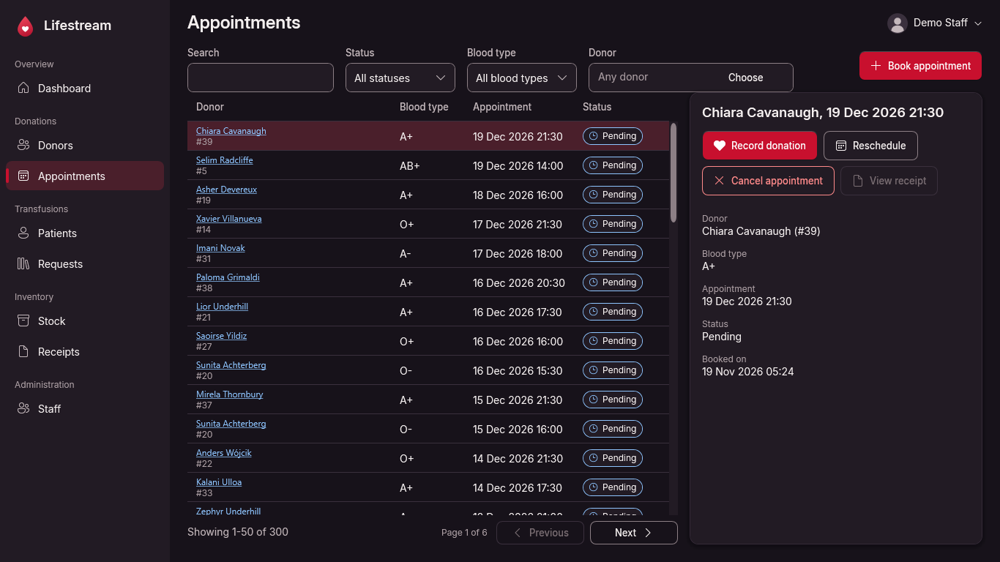
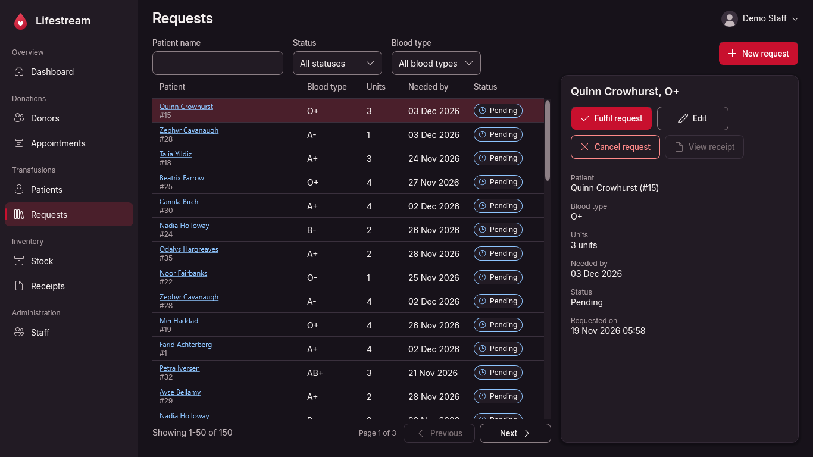
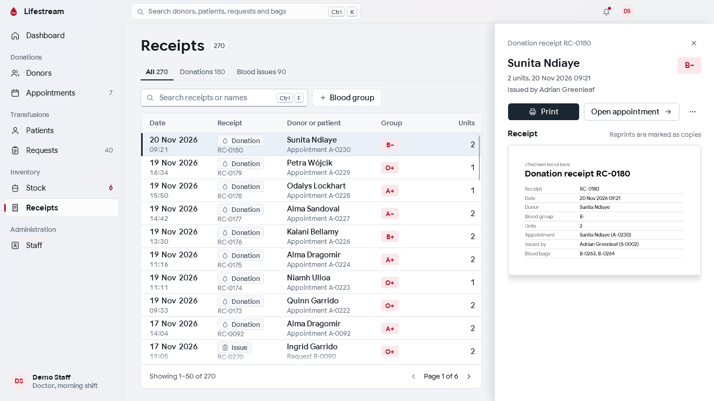
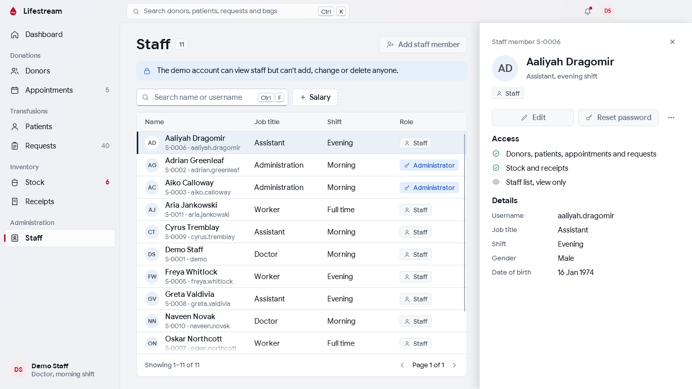
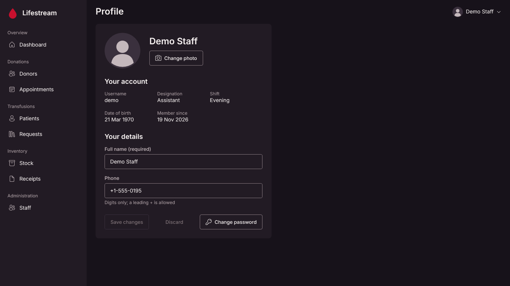
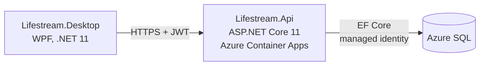

<div align="center">


# Lifestream 2.1

**Blood-bank management for Windows.**<br>
Donors, patients, appointments, blood requests, stock and receipts, with a dashboard that shows the day at a glance.

[](https://github.com/maiznadeem/Lifestream/releases/latest)
[](https://github.com/maiznadeem/Lifestream/actions/workflows/ci.yml)
[](https://github.com/maiznadeem/Lifestream/actions/workflows/secret-scan.yml)


[**Download**](https://github.com/maiznadeem/Lifestream/releases/latest) · [Try the demo](#try-it) · [What's new](CHANGELOG.md) · [Security](docs/SECURITY.md)

<br>


</div>

<br>

Version **2.1.8** is a ground-up rewrite of the original course project on .NET 11: a WPF desktop app that talks to an
ASP.NET Core API on Azure. What changed for users, release by release, is in [CHANGELOG.md](CHANGELOG.md).

- **Everything in one place.** Donors and patients, the day's appointments, blood requests, stock by blood group, receipts and staff.
- **Fast from the keyboard.** Press <kbd>Ctrl</kbd>+<kbd>K</kbd> to find a donor, patient or request, go to any screen, or run an action such as *Record donation*.
- **Light and dark.** Lifestream follows the Windows setting, or you can choose a theme from the account menu.
- **Keeps itself up to date.** The app checks for a newer version when it starts and installs it with a restart.

## Install

1. Open the [v2.1.8 release](https://github.com/maiznadeem/Lifestream/releases/tag/v2.1.8) and download `Lifestream-win-Setup.exe`
   and `SHA256SUMS.txt`. Lifestream runs on Windows 10 or 11, 64-bit.
2. Check the download. In PowerShell, in the folder you saved both files to:

   ```powershell
   $expected = (Get-Content .\SHA256SUMS.txt | Where-Object { $_ -like '*Lifestream-win-Setup.exe' } | Select-Object -First 1) -split ' ' | Select-Object -First 1
   $actual = (Get-FileHash .\Lifestream-win-Setup.exe -Algorithm SHA256).Hash
   if ($actual -eq $expected) { 'MATCH: the download is intact' } else { 'NO MATCH: delete the file and download it again' }
   ```

   `MATCH` means the file is exactly the one that was published. On `NO MATCH`, delete it and download it again.
3. Run the installer. It installs for your user only and needs no administrator rights.

   > The installer is **not code-signed** (a certificate costs money every year), so Windows SmartScreen may say
   > "Windows protected your PC". Choose **More info**, then **Run anyway**.

4. Start Lifestream and press **Try the demo**. No account is needed.

## Try it

Press **Try the demo** on the sign-in screen. There is no account to create and no password to remember.

- **Synthetic data only.** The demo never holds real people's data (see [docs/data-retention.md](docs/data-retention.md)), and it is reset every day.
- **A day in progress.** Today's appointments are already on the list: the earlier ones have donated, the rest are still to come.
  The clinic keeps its hours in UTC (09:00 to 16:30), so they show at those hours in your own time.
- **A sleepy server.** After a quiet spell, the first request can take about a minute and a half while the server and then its
  database wake up. The app says which one it is waiting for.
- **A monthly allowance.** The demo database is on a free plan. If the month's allowance runs out, the app says so, and the
  demo is back on the 1st of the next month.

## Screenshots

<table>
  <tr>
    <td width="50%"><p align="center"><b>Sign in</b></p></td>
    <td width="50%"><p align="center"><b>Donors</b></p></td>
  </tr>
  <tr>
    <td><p align="center"><b>Patients</b></p></td>
    <td><p align="center"><b>Appointments</b></p></td>
  </tr>
  <tr>
    <td><p align="center"><b>Requests</b></p></td>
    <td><p align="center"><b>Stock</b></p></td>
  </tr>
  <tr>
    <td><p align="center"><b>Receipts</b></p></td>
    <td><p align="center"><b>Staff</b></p></td>
  </tr>
  <tr>
    <td><p align="center"><b>Profile</b></p></td>
    <td></td>
  </tr>
</table>

Every screenshot comes from the real app, running against the demo data and never real data. `tools/generate-screenshots.ps1`
fills a fresh local database with the demo data, starts the real API on it, signs in with **Try the demo**, and captures each
screen off-screen. The run fails if a screen shows an error or an empty list, if the dashboard's counts do not match the demo
data, or if the day has no appointments. Times are the demo clinic's (UTC), and
[`screenshots.json`](docs/screenshots/screenshots.json) records when each one was taken. To change a screenshot, run the script
again; never edit the images by hand.

## How it fits together



| Project | What it holds |
|---|---|
| `src/Lifestream.Domain` | Enums (blood types, genders, shifts, statuses) and rules (eligibility, shelf life). No dependencies. |
| `src/Lifestream.Contracts` | Every request and response record, route, header and problem code that the API and the client share. This is the API's frozen surface. |
| `src/Lifestream.Data` | The EF Core context, the migrations, and the generators for demo and scale data. Only the API uses it. |
| `src/Lifestream.Api` | A minimal API with one folder per feature. Nothing else talks to the database. |
| `src/Lifestream.Client` | View models, services and the API client. It references no WPF, EF Core or SqlClient. |
| `src/Lifestream.Desktop` | WPF views, the design system, the app host and the Velopack updater. |
| `tests/*` | One test project per source project, plus UI render tests that run off-screen. |

The full design is in [docs/superpowers/specs](docs/superpowers/specs/2026-11-19-lifestream-overhaul-design.md).
[docs/requirements.md](docs/requirements.md) lists every requirement, with the wording that its proof is written against.
The colours, type and components are in [docs/design-system.md](docs/design-system.md), and the Azure setup and its costs are in
[infra/README.md](infra/README.md).

## For developers

### Build and test

You need the .NET SDK version in `global.json` (11.0.x), on Windows 10 or 11 for the desktop app. SQL Server is needed only for
the data and API tests: set `LIFESTREAM_TEST_SQL`, or leave it unset to use the local default instance with Windows authentication.

```powershell
dotnet build Lifestream.slnx -c Release
dotnet test  Lifestream.slnx -c Release --no-build
```

Every warning fails the build. Nullable reference types are on, analyzers flag unused code and usings and undisposed resources,
and the NuGet audit runs at high severity. Package versions are pinned in one place, `Directory.Packages.props`.

### Run

```powershell
dotnet run --project src/Lifestream.Api         # the API on http://localhost:5080; GET /healthz to check it
dotnet run --project src/Lifestream.Desktop     # the desktop client
```

### Releases

Installers are on the [Releases page](https://github.com/maiznadeem/Lifestream/releases), each with its SHA-256 checksums (see
[Install](#install)). Each release's notes are its section of [CHANGELOG.md](CHANGELOG.md).

<details>
<summary>How a release is made</summary>

<br>

A release is made on the maintainer's PC, not in GitHub Actions, where the minutes are limited. First, put the version in
`Directory.Build.props` and its `CHANGELOG.md` section on `master`, and pass the build and the tests locally. Then run:

```powershell
pwsh tools/release-local.ps1 -Version <version> -DryRun   # publish, scan, pack, scan, checksums: nothing leaves the PC
pwsh tools/release-local.ps1 -Version <version>           # the same, then the GitHub release and its tag
```

The script refuses to run unless the working tree is clean, `HEAD` is the commit that `master` points at on GitHub, the version
matches and the tag is free. Then, in order, it:

1. publishes the desktop app (self-contained, win-x64, ReadyToRun) and scans the publish folder for credentials;
2. packs the installer and the update packages with Velopack, scans those too, and writes `SHA256SUMS.txt`;
3. creates the release as a draft at that commit, uploads the files, and checks them against what GitHub received;
4. publishes the release, which creates the tag `v<version>`.

A tag starts no workflow. `release.yml` does the same on a GitHub runner, but only when started by hand, as a fallback (see the
comment at its top).

</details>

### Continuous integration

Only short jobs start by themselves. The full build and every test run locally before each push.

| Workflow | Starts on | Does | Time |
|---|---|---|---|
| `ci.yml` | pull request, push to `master` | job `fast`: builds Client and Domain with their tests and runs them | 90 second budget, checked by the job itself |
| `secret-scan.yml` | pull request, push to `master` | job `repository`: credential scan of the source and of the new commits | about 20 seconds |
| `secret-scan.yml` | Mondays 04:17 UTC | job `history`: credential scan of the whole history, every branch and tag | under a minute |
| `cloudflare-ranges.yml` | Mondays 05:23 UTC | compares the API's ingress allow-list with Cloudflare's published IPv4 ranges; a failure is the alert | about 10 seconds |
| `deploy-api.yml` | push to `master` that changes the API, its libraries or `infra/` (Markdown-only changes excluded) | builds and scans the image, migrates, updates the app, checks `/healthz` | about 5 minutes, most of it Azure applying the migration and the rollout |

Everything else runs only when started by hand (Actions, then the workflow, then **Run workflow**):

- the full `api`, `desktop` and `test-order` jobs of `ci.yml`;
- the `desktop` and `api-image` scans of `secret-scan.yml` (a run started by hand also scans the whole history);
- `release.yml`, `screenshots.yml` and `sync-sql-firewall.yml`.

### Deployment

The API is public only at `api.lifestream.himaiz.com`: a Cloudflare Worker that forwards to Azure Container Apps, whose own address
accepts only Cloudflare. [docs/deployment.md](docs/deployment.md) records the whole live setup:
- hosting and domains;
- CI and CD, including the Worker's automatic deploys from `edge/api`;
- the Cloudflare WAF and origin lock, and bot protection;
- secrets (names and places only), and the database;
- how to roll back each part.

## Security

To report a vulnerability, see [docs/SECURITY.md](docs/SECURITY.md). It also explains what the old history holds: two
database logins from 1.x, neither of which works any more.

## Repository rules

These are never committed, and git ignores them:

- database dumps and backups (`*.bak`, `*.bacpac`, `*.rar`);
- certificates (`*.pfx`);
- `publish/` output;
- `.env` files.

Documentation and the generated screenshots live under `docs/`.
