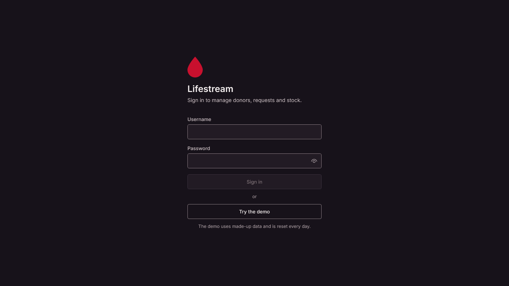
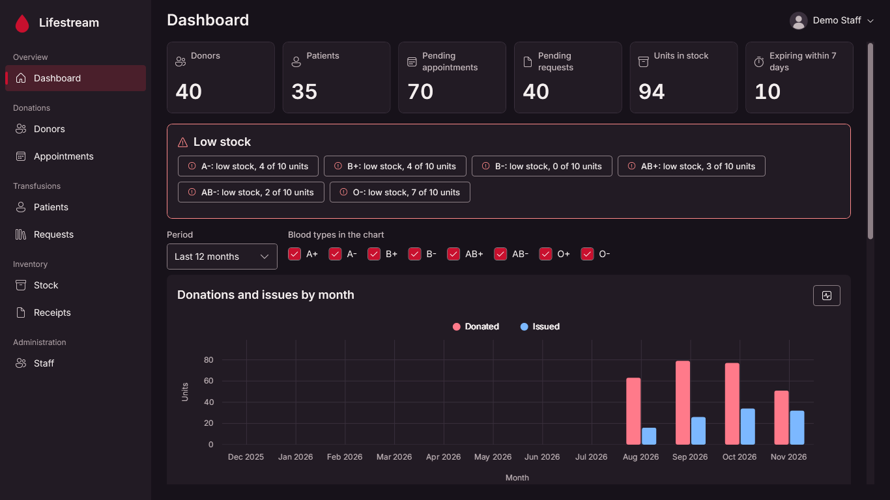
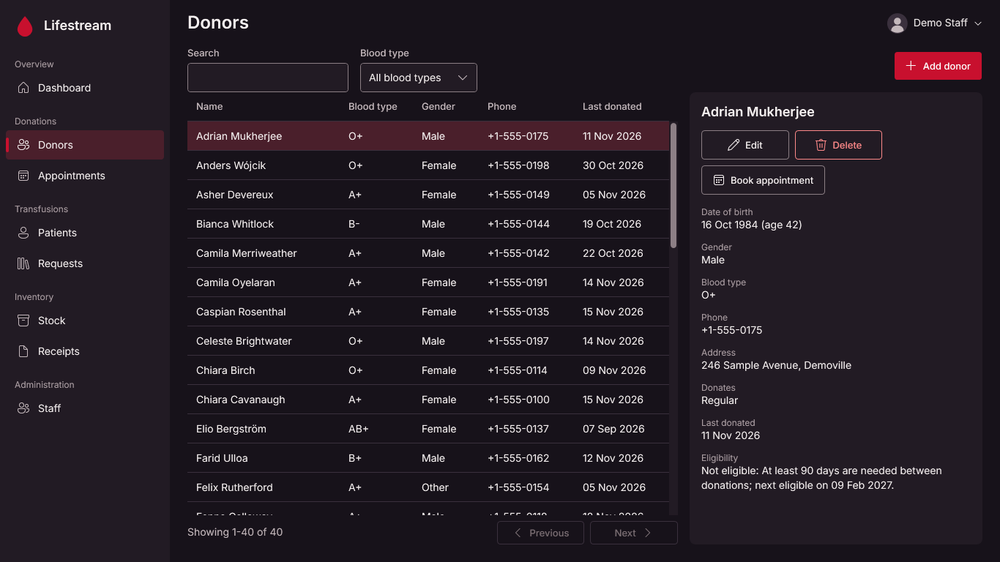
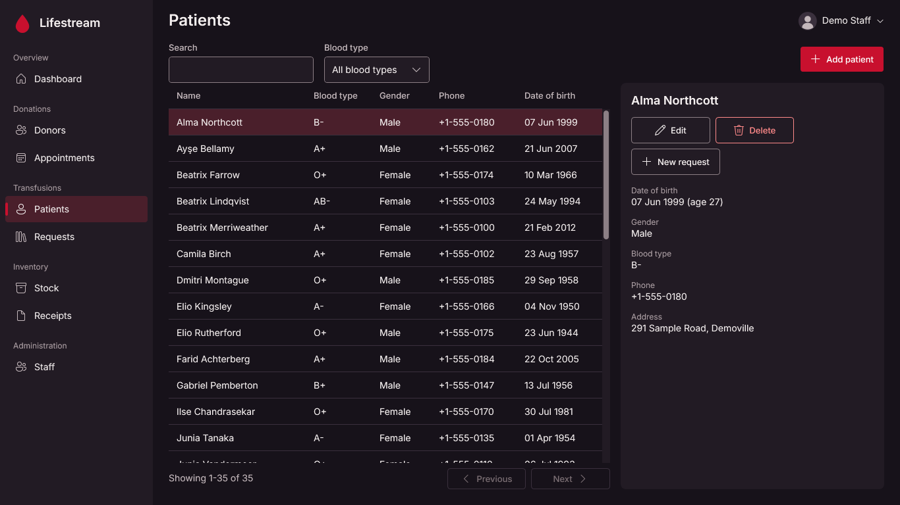
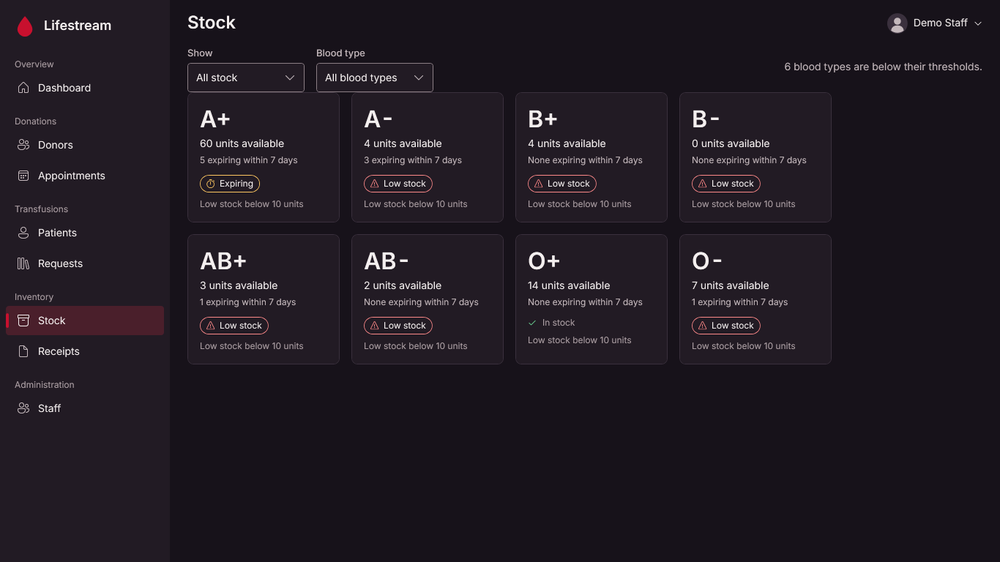

# Lifestream 2.0

Lifestream is a blood-bank management desktop app: donors, patients, appointments, blood requests, stock and receipts,
with a dashboard. Version **2.0.0** is a ground-up rewrite of the original course project on .NET 11.

> Status: the solution skeleton is in place (contracts, build rules, CI, desktop stack spike). The database, API
> endpoints and screens are being built on top of it; see `docs/superpowers/plans/2026-11-19-lifestream-overhaul.md`.

## Try it (demo login)

Start the app and press **Try the demo**. No account, username or password is needed. The demo runs against synthetic
data only (see [docs/data-retention.md](docs/data-retention.md)), is reset every day, and has a **Reset demo data**
action. The first request after a quiet period can take up to a minute while the server wakes up.

## Screenshots

Rendered off-screen through the real app from the real demo dataset (never real data) by `tools/generate-screenshots.ps1`:
it fills a fresh local database with the demo data generator, starts the real API over it, signs in with "Try the demo" and
captures every screen. A screen that shows an error or empty state, or a dashboard whose counts differ from the demo
dataset's, fails the run. Regenerate them by running that script, never edit them by hand.

| | |
|---|---|
|  |  |
|  |  |
|  |  |
|  |  |
|  | |

## Architecture

```
Lifestream.Desktop (WPF, .NET 11)  --HTTPS + JWT-->  Lifestream.Api (ASP.NET Core 11, Azure Container Apps)
                                                          |
                                                          v  EF Core, managed identity
                                                     Azure SQL
```

| Project | What it holds |
|---|---|
| `src/Lifestream.Domain` | Enums (blood types, genders, shifts, statuses) and rules (eligibility, shelf life). No dependencies. |
| `src/Lifestream.Contracts` | Every request/response record, route, header and problem code shared by API and client. Frozen API surface. |
| `src/Lifestream.Data` | EF Core context, migrations, demo and scale data generators. Used only by the API. |
| `src/Lifestream.Api` | Minimal API, one folder per feature. The only code that talks to the database. |
| `src/Lifestream.Client` | View models, services and the API client. No WPF, EF Core or SqlClient reference. |
| `src/Lifestream.Desktop` | WPF views, design system, app host, Velopack updater. |
| `tests/*` | One test project per source project, plus off-screen UI render tests. |

The full design is in [docs/superpowers/specs](docs/superpowers/specs/2026-11-19-lifestream-overhaul-design.md); every
requirement, with the wording each proof is written against, is in [docs/requirements.md](docs/requirements.md).

## Build and test

Requirements: the .NET SDK version in `global.json` (11.0.x) on Windows 10/11 for the desktop app. SQL Server is only
needed for the data and API tests (set `LIFESTREAM_TEST_SQL`; it defaults to the local default instance with Windows
authentication).

```
dotnet build Lifestream.slnx -c Release
dotnet test  Lifestream.slnx -c Release --no-build
```

The build treats every warning as an error (nullable enabled, analyzers for unused code and usings and undisposed
resources, NuGet audit at high severity). Package versions are pinned centrally in `Directory.Packages.props`.

## Run

```
dotnet run --project src/Lifestream.Api         # API on http://localhost:5080, GET /healthz
dotnet run --project src/Lifestream.Desktop     # desktop client
```

## Releases

Installers are published on the [GitHub Releases page](../../releases) with SHA-256 checksums. They are not code-signed,
so Windows SmartScreen shows a "More info, Run anyway" prompt; compare the checksum before running.

## Repository rules

Database dumps and backups (`*.bak`, `*.bacpac`, `*.rar`), certificates (`*.pfx`), `publish/` output and `.env` files
are git-ignored and never committed. Documentation and generated screenshots live under `docs/`.
