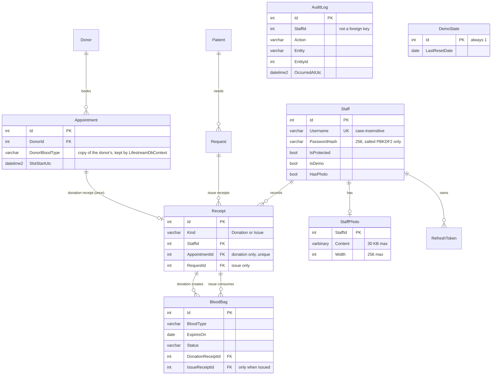

# Database

Azure SQL (SQL Server) behind the API, reached only through EF Core in `src/Lifestream.Data`. The schema exists only as
versioned EF Core migrations applied to an empty database; there is no hand-run SQL, no trigger, no function and no stored
procedure.

## Entity-relationship diagram

## Conventions

- Tables are singular PascalCase (`Donor`, `BloodBag`); columns are PascalCase; no underscores.
- Every table has an `int` identity `Id` (`StaffPhoto` is keyed by its `StaffId`). Foreign keys are `int`, named `<Thing>Id`,
  and every one has an index that starts with it.
- Enums (blood type, gender, designation, shift, role, every status, receipt kind) are stored as their names in `varchar`
  and guarded by a `CHECK` constraint built from the enum, so an unknown value is rejected by the database.
- Timestamps are `datetime2(3)` in UTC, columns end in `Utc`, and defaults use `SYSUTCDATETIME()` (the server clock, never a
  client clock). Date-only values (`DateOfBirth`, `LastDonated`, `RequiredBy`, `ExpiresOn`, `LastResetDate`) are `date`.
- Editable rows (`Donor`, `Patient`, `Staff`, `Appointment`, `Request`) carry a `rowversion` for optimistic concurrency.
- `Staff.Username` is unique with the case-insensitive collation pinned on the column. `Donor.Name`, `Patient.Name` and
  `Staff.DisplayName` use `Latin1_General_100_CI_AI` so a search is case- and accent-insensitive without a function on the column.
- `Staff.PasswordHash` is `varchar(256)` with a `CHECK` that it is an ASP.NET Core Identity v3 hash
  (PBKDF2-HMAC-SHA512, base64, header `AQAAAAIA....AAAAE`, 84 to 256 characters). Plain text cannot be stored. `PasswordHashing` uses 600,000 iterations.
- Staff photos live in `StaffPhoto` (at most 30 KB, 256 px). `Staff.HasPhoto` tells the API a photo exists, so a Staff query
  never touches the photo table.
- `Receipt` is one table for both directions. A `CHECK` requires an appointment (and no request) for a `Donation` and a
  request (and no appointment) for an `Issue`; a filtered unique index on `AppointmentId` lets an appointment be receipted once.
- `BloodBag` holds one row per unit. `ExpiresOn` is collection date plus 42 days, defined once in `StockRules` (with the
  3-day "fresh" window). A bag is `Issued` only together with an `IssueReceiptId`.

## Decisions recorded here

- **Attendance** (the old app's table, with no screen in the old app) is **absent**: it is not in any migration and has no endpoint.
  `BloodBag` is kept. (Owner decision DB-17, default taken.)
- **Audit.** Every insert, update and delete on `Donor`, `Patient`, `Request`, `Receipt`, `Appointment` and `Staff` writes an
  `AuditLog` row (user id from `LifestreamDbContext.CurrentStaffId`, action, entity, entity id, server UTC time) from
  `SaveChanges`/`SaveChangesAsync`, every overload. The change and its audit rows commit atomically: when the caller has no
  transaction open, the save opens one (inside the EF execution strategy, so a retry repeats the whole thing) and commits only
  after the audit rows are written; when the caller owns a transaction, the audit rows join it. The business rows are saved
  with `acceptAllChangesOnSuccess: false` first, so the audit row carries the real generated id, and the change tracker is
  accepted only after both writes succeeded (a failed attempt puts temporary ids back, so a retry inserts a new row instead
  of a duplicate). Bulk system work (generators, the demo reset) turns auditing off with `AuditEnabled = false`.
- **Bulk changes bypass auditing.** `ExecuteUpdate`/`ExecuteDelete` (and raw SQL) skip the change tracker, so EF cannot audit
  them. For the six audited tables use `LifestreamDbContext.BulkDeleteAsync(query)` / `BulkUpdateAsync(query, setters)`: they
  select the ids, change exactly those rows and write one audit row per id in one serializable transaction (or the caller's).
  Never call `ExecuteDeleteAsync`/`ExecuteUpdateAsync` on `Donors`, `Patients`, `Appointments`, `Requests`, `Receipts` or `Staff`
  from the API.
- **UTC only.** Every `DateTime` column is `datetime2(3)` with a value converter (`UtcDateTimeConverter`): writing a
  `DateTime` whose `Kind` is `Local` or `Unspecified` throws an `ArgumentException` ("must have Kind=Utc"), and values read
  back have `Kind=Utc`. The same applies to a `DateTime` used as a query parameter. Timestamps the server owns
  (`PlacedAtUtc`, `CreatedAtUtc`, `OccurredAtUtc`) default to `SYSUTCDATETIME()`; the client never supplies them.
- **Password hash check.** `CK_Staff_PasswordHash` accepts only text shaped like an Identity v3 hash as far as T-SQL can tell:
  base64 alphabet, padding only at the end, length a multiple of 4 and between 84 and 256, and the exact header (version
  byte 1, PRF HMAC-SHA512, iteration count under 2^24, salt length 16). It cannot decode base64 (no functions or XML methods
  in a CHECK), so the iteration floor and randomness stay with `PasswordHashing.IsValidHash`, which the tests apply to every
  Staff row of a seeded database.
- **List queries and indexes (DB-05).** Every filter and sort the `*Query` records allow is served by an index; the plan
  tests (`ListQueryPlanTests`) run the whole matrix (each filter alone and with each sort, page 1 and page 261, plus the
  total count) at 100x and fail on any scan of a table over 5,000 rows. Rules the API follows to stay inside it:
  - Sorts are `ORDER BY <indexed key>, Id` (the nonclustered indexes end in the clustered key `Id`, so key + id is the
    keyset order). Supported sorts: donors `name`, `lastDonated`; patients `name`; appointments `slot`, `placed`; requests
    `placed`, `requiredBy`; receipts `date`; staff `name`, `username` (each ascending or descending). Any other sort value is
    a 400, not a slow query.
  - Name search is a **prefix** match on the indexed, case- and accent-insensitive name column
    (`SearchQueries.NameStartsWith`, `DonorNameStartsWith`, `PatientNameStartsWith`, `PartyNameStartsWith`); contains-search is
    not offered. Never use `string.StartsWith(variable)`: EF turns it into `LEFT(col, LEN(@p)) = @p`, which is not seekable.
  - Appointment search by donor name and request search by patient name are two steps: the ids of the matching donors or
    patients (`SearchQueries.DonorIdsByNamePrefixAsync` / `PatientIdsByNamePrefixAsync`, a seek on the name index), then the
    rows whose `DonorId`/`PatientId` is in that list (a seek per id on a covering index). In one statement with a join the
    optimizer scans the appointment or request table instead.
  - "Appointments of donors with blood type X" uses `Appointment.DonorBloodType`, a copy of the donor's blood type kept by
    `LifestreamDbContext` (set when an appointment is added, rewritten in the same transaction when the donor's blood type
    changes; only with `AuditEnabled`, so generators set it themselves). It makes the filter one index seek instead of a join.
  - Receipt search by donor or patient name uses two seek paths joined by `UNION` (name, then appointment/request, then
    receipt), because one `OR` across both would scan.
  - Deep pages (`Skip` in the thousands) read only the narrow sort index and fetch the 50 rows by id
    (`ListPaging.PageById`), instead of scanning the table for the columns the page needs.
- **No logic in the database.** Donation (receipt, bags, completing the appointment, `Donor.LastDonated`) and issue (oldest
  unexpired bags first) are API code inside transactions.
- **Ids after a demo reset are not restarted** (`DBCC CHECKIDENT` and `IDENTITY_INSERT` need `ALTER`, which the API identity
  does not have). Compare content, not ids.

## Data you can load

All data comes from code, never from a backup.

- `DemoDataGenerator.Generate(today)`: 11 staff (one is the public `demo` account), 40 donors, 35 patients, 300 appointments,
  150 requests, 270 receipts and their bags. Dates are relative to `today`. The same date always gives the same rows.
  Names come from two lists in `SyntheticVocabulary`, phones are in the fictional range `+1-555-0100` to `+1-555-0199`,
  addresses are on "Sample" streets in "Demoville". Every staff row holds the hash of a random password that was thrown away, so no
  seeded account has a known password; the demo login issues a token without one.
- `ScaleDataGenerator.Generate(100)`: exactly 100 times the above (27,000 receipts, 30,000 appointments, 15,000 requests),
  for performance tests. `ScaleDatabaseFixture` in the tests loads it into a throwaway database.
- `DemoReset.RunIfDueAsync` / `ForceAsync` rebuild every table from the generator, keeping protected staff (the owner admin).

## Add a migration

Install the EF tool once (the repository pins no global tool): `dotnet tool install dotnet-ef --tool-path <folder> --version "11.*"`.

1. Change the entities or `Configurations/`.
2. `dotnet-ef migrations add <Name> --project src/Lifestream.Data --output-dir Migrations`
3. Read the generated `Up`; EF never writes data fixes for you.
4. Regenerate the idempotent script and commit it with the migration:
   `dotnet-ef migrations script --idempotent --project src/Lifestream.Data --output src/Lifestream.Data/Migrations/idempotent.sql`
5. `dotnet test Lifestream.slnx -c Release`. `Migrations_ApplyToEmptyDatabase_NoPendingChanges` fails if the model and the
   migrations disagree, and `IdempotentScript_Committed_MatchesWhatTheMigrationsGenerate` fails if step 4 was forgotten.

Never edit an applied migration. Add a new one.

## Tests

`tests/Lifestream.Api.Tests/Data/` runs against a real SQL Server named by `LIFESTREAM_TEST_SQL` (default
`Server=localhost;Integrated Security=true;TrustServerCertificate=true`). Each test class gets a database called
`Lifestream_Test_<guid>`, created by the migrations and dropped by the fixture, which checks the drop.
