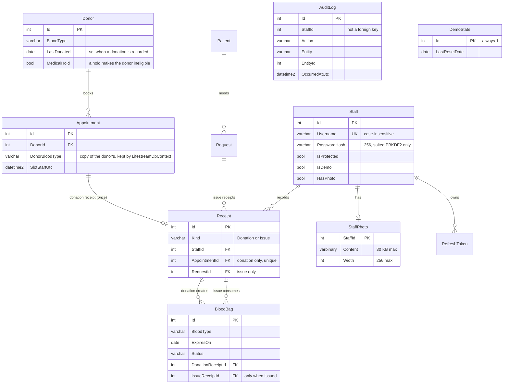

# Database

Azure SQL (SQL Server) behind the API, reached only through EF Core in `src/Lifestream.Data`. The schema exists only as
versioned EF Core migrations applied to an empty database; there is no hand-run SQL, no trigger, no function and no stored
procedure.

## Entity-relationship diagram

## Conventions

- Tables are singular PascalCase (`Donor`, `BloodBag`); columns are PascalCase; no underscores.
- Every table has an `int` identity `Id` (`StaffPhoto` is keyed by its `StaffId`). Foreign keys are `int`, named `<Thing>Id`,
  and every one has an index that starts with it.
- Enums (blood type, gender, designation, shift, role, every status, receipt kind) are stored as their names in `varchar`
  and guarded by a `CHECK` constraint built from the enum, so an unknown value is rejected by the database.
- Timestamps are `datetime2(3)` in UTC, columns end in `Utc`, and defaults use `SYSUTCDATETIME()` (the server clock, never a
  client clock). Date-only values (`DateOfBirth`, `LastDonated`, `RequiredBy`, `ExpiresOn`, `LastResetDate`) are `date`.
- Editable rows (`Donor`, `Patient`, `Staff`, `Appointment`, `Request`) carry a `rowversion` for optimistic concurrency.
- `Staff.Username` is unique with the case-insensitive collation pinned on the column. `Donor.Name`, `Patient.Name` and
  `Staff.DisplayName` use `Latin1_General_100_CI_AI` so a search is case- and accent-insensitive without a function on the column.
- `Staff.PasswordHash` is `varchar(256)` with a `CHECK` that it is an ASP.NET Core Identity v3 hash
  (PBKDF2-HMAC-SHA512, base64, header `AQAAAAIA....AAAAE`, 84 to 256 characters). Plain text cannot be stored. `PasswordHashing` uses 600,000 iterations.
- Staff photos live in `StaffPhoto` (at most 30 KB, 256 px). `Staff.HasPhoto` tells the API a photo exists, so a Staff query
  never touches the photo table.
- `Receipt` is one table for both directions. A `CHECK` requires an appointment (and no request) for a `Donation` and a
  request (and no appointment) for an `Issue`; a filtered unique index on `AppointmentId` lets an appointment be receipted once.
- `BloodBag` holds one row per unit. `ExpiresOn` is collection date plus 42 days, defined once in `StockRules` (with the
  3-day "fresh" window). A bag is `Issued` only together with an `IssueReceiptId`.

## Decisions recorded here

- **Attendance** (the old app's table, with no screen in the old app) is **absent**: it is not in any migration and has no endpoint.
  `BloodBag` is kept. (Owner decision DB-17, default taken.)
- **Audit.** Every insert, update and delete on `Donor`, `Patient`, `Request`, `Receipt`, `Appointment` and `Staff` writes an
  `AuditLog` row (user id from `LifestreamDbContext.CurrentStaffId`, action, entity, entity id, server UTC time) from
  `SaveChanges`/`SaveChangesAsync`, every overload. The change and its audit rows commit atomically: when the caller has no
  transaction open, the save opens one (inside the EF execution strategy, so a retry repeats the whole thing) and commits only
  after the audit rows are written; when the caller owns a transaction, the audit rows join it. The business rows are saved
  with `acceptAllChangesOnSuccess: false` first, so the audit row carries the real generated id, and the change tracker is
  accepted only after both writes succeeded (a failed attempt puts temporary ids back, so a retry inserts a new row instead
  of a duplicate). Bulk system work (generators, the demo reset) turns auditing off with `AuditEnabled = false`.
  The appointments that a donor's blood-type change rewrites (`Appointment.DonorBloodType`) are audited too: one `Update` audit
  row per rewritten appointment, written in the same transaction as the donor's change, and appointments the context tracks are
  brought up to date (new blood type and new row version) so editing one next is not a concurrency error; a failed save undoes
  that refresh. `BulkUpdateAsync` on `Donor.BloodType` does the same for the donors it changes.
- **Bulk changes bypass auditing.** `ExecuteUpdate`/`ExecuteDelete` (and raw SQL) skip the change tracker, so EF cannot audit
  them. For the six audited tables use `LifestreamDbContext.BulkDeleteAsync(query)` / `BulkUpdateAsync(query, setters)`: they
  select the ids, change exactly those rows and write one audit row per id in one serializable transaction (or the caller's).
  Never call `ExecuteDeleteAsync`/`ExecuteUpdateAsync` on `Donors`, `Patients`, `Appointments`, `Requests`, `Receipts` or `Staff`
  from the API.
- **UTC only.** Every `DateTime` column is `datetime2(3)` with a value converter (`UtcDateTimeConverter`): writing a
  `DateTime` whose `Kind` is `Local` or `Unspecified` throws an `ArgumentException` ("must have Kind=Utc"), and values read
  back have `Kind=Utc`. The same applies to a `DateTime` used as a query parameter. Timestamps the server owns
  (`PlacedAtUtc`, `CreatedAtUtc`, `OccurredAtUtc`) default to `SYSUTCDATETIME()`; the client never supplies them.
  `ServerClockAndRangeTests` proves it through the API: a client whose clock is five hours ahead (the `Date` header, other
  time headers and made-up `placedAtUtc`/`createdAtUtc`/`collectedAtUtc` body fields) gets rows whose stamps are within seconds
  of the database server's UTC clock.
- **Date ranges are half-open** (DB-13): `>= start of the From day` and `< start of the day after the To day`, so a record at
  23:59:59.999 on the To date is in and one at 00:00 the next day is out (`Lists.DayRange`; the dashboard does the same in the
  caller's offset). Proven through the API for receipts, requests, appointments and the dashboard series.
- **Password hash check.** `CK_Staff_PasswordHash` accepts only text shaped like an Identity v3 hash as far as T-SQL can tell:
  base64 alphabet, padding only at the end, length a multiple of 4 and between 84 and 256, and the exact header (version
  byte 1, PRF HMAC-SHA512, iteration count under 2^24, salt length 16). It cannot decode base64 (no functions or XML methods
  in a CHECK), so the iteration floor and randomness stay with `PasswordHashing.IsValidHash`, which the tests apply to every
  Staff row of a seeded database.
- **List queries and indexes (DB-05).** The API answers every list with **one SQL command** (the page and the total together,
  API-22). `ApiPlanMatrixTests` drives the real endpoints (WebApplicationFactory over a 100x database on a real SQL Server),
  records the SQL and parameters each request sends (an EF command interceptor), replays each statement under
  `SET STATISTICS XML ON` and fails on a Table Scan or Clustered Index Scan of any table over 5,000 rows, and on a second
  database call. The matrix uses common values (requests `Fulfilled`, appointments `Completed`, blood type `OPos`), one- and
  two-letter searches, every documented sort, page 1 and a deep page, plus lookups, stock, dashboard and eligibility; it also
  checks that every filter property of every `*Query` record appears in it. `LIFESTREAM_PLAN_CAPTURE=<file>` writes each
  request's operators, rows, executions and SQL. How the queries are built:
  - Sorts are `ORDER BY <indexed key>, Id`. Supported sorts: donors `name`, `lastDonated`; patients `name`; appointments
    `slot`, `placed`; requests `placed`, `requiredBy`; receipts `date`; staff `name`, `username` (each ascending or
    descending). Any other sort value is a 400, not a slow query.
  - **Covering indexes.** Each index a list is sorted or filtered by ends in the sort column (after the equality filters) and
    INCLUDEs the columns the list shows, so a page is read in order from one index and stops after 50 rows (appointments:
    status, donor blood type, slot or placed; requests: status, blood type, placed or requiredBy; receipts: kind, blood type,
    date; donors and patients: name, blood type + name, last donated). A wide covering index is as wide as the table itself, so
    each of these tables also has a **single-column foreign-key index** (`Appointment.DonorId`, `Request.PatientId`, the three
    `Receipt` keys): it is the narrowest index and is what `COUNT(*)` and joins read, rather than the clustered index.
  - **Bulk-loaded databases need maintenance before plans mean anything.** Rows arrive in clustered-key order but in random
    order for every other index, so the nonclustered indexes of a freshly loaded table are half empty, look bigger than the table
    itself, and the optimizer then prefers to scan the clustered index; automatic statistics are also sampled, and a sample differs
    from run to run. The 100x test fixture therefore runs `ALTER INDEX ALL ... REBUILD` and `UPDATE STATISTICS ... WITH FULLSCAN`
    on every large table after loading, the maintenance a production database gets. Without it, one-letter receipt searches (the
    staff-name branch) still show a Clustered Index Scan of `Receipt` in the plan matrix (8 cases).
  - **The total is a one-row cross join** (`Lists.Total`: `GROUP BY` a constant), not a scalar subquery in the page's select
    list, which SQL Server may work out again for every row. The patient list joins the page back to `Patient` before it counts
    each patient's pending requests, so the count is worked out for 50 rows and not for every row the `OFFSET` skips.
  - **Search** (`SearchQueries`, one rule for every list, the pickers and the command palette). The text is split into words and
    **every word must match**, in any order; at most five words. A word that is a blood group ("O-", "ab+") matches that blood
    group on a list that shows one, and nothing else; the list's own record code ("D-0041") matches that record. Any other
    word matches a name that **contains** it ("eastw" finds "Selim Eastwood", "ali" finds "Aaliyah"), without regard to case or
    accents (the name columns' collation); a word of one or two characters only where a word of the name **starts** ("a" finds
    "Aaliyah Mukherjee" and "Selim Abernathy", not "Dalia Novak"). Digits are looked for in names like any word ("Unknown Male
    3") and also as the record's number and, from three digits, inside phone numbers (the stored number is compared by its
    digits, and digits typed with spaces are one number: "5550156" and "555 0156" find "+1-555-0156"). Appointments are
    searched through their donor, requests through their patient, receipts through their donor or patient and the staff member
    who issued them. Staff are searched by name, user name and code, never by phone: a staff member's phone is private (only
    an administrator sees it).
    - *Why it is not a seek.* Until 2.1.2 a search was a prefix of the whole `Name` column, which seeks the name index and is why
      a last name was never found. A match anywhere after the first letter of the name cannot seek any index there is, a later
      word's first letter as little as the middle of a word, so both cost the same: the name index of `Donor`, `Patient` or
      `Staff` is read whole (46, 34 and 8 pages at 100x; 1 to 3 ms). The big tables are never searched by text: they are
      reached through the ids of the people found.
    - *Why one and two letters match word starts only.* What a search costs is the rows it finds in the big tables. One letter
      is inside nine names in ten, so it finds nine receipts in ten and has them joined, counted and sorted: 100 to 135 ms for
      the receipt list at 100x, against 60 before. At word starts "a" finds a fifth of the names.
    - *Appointments and requests* are filtered by `DonorId IN (ids of the donors found)`, every word that can only match
      through the person in ONE subquery. A word of digits may be the row's own number instead: the row with that number and
      the other rows of the people found, two sets with nothing in common, put together with `UNION ALL`
      (`Id = n OR DonorId IN (...)`, as it was written before, read 60,000 pages at 100x: SQL Server answers an `OR` over a
      subquery row by row).
    - *Receipts* (`SearchQueries.ReceiptsMatching`) have two statements. A search whose longest word is a text, or seven
      digits or more of a phone, which is nearly every search, starts from the receipts that word finds: three chains that
      start at the people found (donor, appointment, receipt; patient, request, receipt; staff, receipt), joined by `UNION`,
      the statement the search had before. Further words are checked on the receipts found, each chain carrying the ids of
      the receipt's donor or patient and staff member. Any other search (three to six digits, which may be in every phone:
      an area code; one or two letters with other words) is answered by a statement that costs the same whatever it finds:
      a receipt has one party, a donation its appointment's donor and an issue its request's patient, so the two kinds are
      worked out apart and put together with `UNION ALL` (nothing is found twice, nothing has to be made distinct), each
      half joined to its appointment or request and `LEFT JOIN`ed per word to the ids of the people and staff that match.
      The chains are not used there because SQL Server sizes the memory of their `UNION` for 9 % of the people, and with 91 %
      it spills to disk (500 ms). The matches are filtered by blood type and date, counted and ordered as (id, date, kind,
      blood type) rows, and only the 50 receipts of the page are then fetched by id. The receipt search is the slowest
      search: it works the matches out twice, once to count and once for the page.
    - *The plan* (`SearchPlanInterceptor`). SQL Server cannot estimate how many names contain a word: it assumes 9 % of them
      for every word. With that guess and a page of 50 to fill it reads the big table in the list's order and looks each
      row's person up until it has 50 matches, which is the whole table when few match (9,000 pages for a last name). Every
      statement with a search is therefore tagged by the search itself and sent with
      `OPTION (USE HINT ('DISABLE_OPTIMIZER_ROWGOAL'))`. The appointment and request searches also get `LOOP JOIN`: from the
      people found, one index seek per person (7 ms for a name where joining the whole index takes 15; the same 31 ms for a
      word in most names, with more pages read: 28,000 against 400). Recompiling for each term (`OPTION (RECOMPILE)`, the
      earlier design) chose well for a prefix, which SQL Server can estimate from the index; for "contains" it would compile
      the same plan every time, 10 ms a request (50 ms and more for the receipt search).
    - *What would make it a seek.* A migration: a table of name words (person, word) with an index on the word, or a
      full-text index on the three name columns, for word starts; nothing short of an n-gram index for the middle of a word.
      Not needed at this size: the read grows with the number of people (not of appointments or receipts) and is 3 ms at 100x.
      The receipt search would gain most from the donor or patient id being stored on `Receipt` (as `Appointment` stores
      `DonorBloodType`): its joins to `Appointment` and `Request`, most of its cost, would go, and with them the need for two
      statements.
  - "Appointments of donors with blood type X" uses `Appointment.DonorBloodType`, a copy of the donor's blood type kept by
    `LifestreamDbContext` (set when an appointment is added; rewritten in the same transaction when the donor's blood type
    changes, with an audit row per rewritten appointment; see Audit). A `BulkUpdateAsync` of `Donor.BloodType` keeps it in
    sync in the same way.
  - The old `ListQueryPlanTests`/`ListPaging` plan tests (a two-step ids-then-rows stand-in) are kept as extra checks of the
    data module's helpers; the API does not use `ListPaging`, because two steps would be two database calls.
- **Medical hold (API-11).** `Donor.MedicalHold` (bit, default 0) is part of eligibility: age 18-60, at least 90 days since the
  last donation, and no hold. `Eligibility.Evaluate(dateOfBirth, lastDonation, today, medicalHold)` is computed on the server
  for `GET donors/{id}/eligibility` and for booking and rescheduling an appointment (judged on the slot's day). A donor who is
  not eligible can be given a slot only with an override reason, stored on the appointment. Rescheduling takes the reason the
  appointment already carries, because `RescheduleAppointmentRequest` has no field for a new one.
- **No logic in the database.** Donation (receipt, bags, completing the appointment, `Donor.LastDonated`) and issue (oldest
  unexpired bags first) are API code inside transactions. `TransactionTests` makes the database fail at a named step of a donation or an issue (a command interceptor in the
  API host) and checks that no receipt, bag, audit row or status change remains.
- **Ids after a demo reset are not restarted** (`DBCC CHECKIDENT` and `IDENTITY_INSERT` need `ALTER`, which the API identity
  does not have). Compare content, not ids.

## Data you can load

All data comes from code, never from a backup.

- `DemoDataGenerator.Generate(nowUtc)`: 11 staff (one is the public `demo` account), 100 donors, 35 patients, 300 appointments,
  150 requests, 270 receipts and their bags, as the clinic stands at that instant (the moment of the reset). Dates are relative to its UTC date,
  and the same instant always gives the same rows. `Generate(today)` is the clinic at 00:00 UTC of that date.
  - **The demo has a today.** Yesterday, today and tomorrow (UTC) each hold a clinic day: one appointment in every hour the clinic is open
    (09 to 16 UTC), on the hour or the half hour. The data of a reset is seen while the UTC date is still the reset's, and a viewer's local day is
    a 24-hour window around "now", so it lies inside those three days and holds one appointment per clinic hour (at least 7 of the 8: local midnight
    can fall between an hour and its half hour). So the Today view, the dashboard's panel and the sidebar count have a clinic day in every time zone.
  - **Done or still to come is decided against the instant.** An appointment whose slot started 45 minutes or more before the reset is over: completed,
    with its receipt, its bags and the donor's last donation exactly as the API records a donation (or it is that day's one no-show). Every other
    appointment is pending. Nothing is done before its time and no row carries a time after the reset, in any time zone. What can happen is the
    reverse: an appointment whose time passes after the reset stays pending until someone records it, as in the app itself.
  - The last appointment of today and of tomorrow belongs to a donor who has never donated; today's and tomorrow's other donors last donated more
    than 90 days ago (a few of them not yet either), so they are eligible. The totals do not depend on the time of day (`SeedSizes`): today's rows
    come out of the same counts.
  - **Nobody breaks the donation rule** (`Eligibility.MinDaysBetweenDonations`, and the age limits). A donor's donations are at least that many days
    apart; every appointment, whatever became of it, is on a day the donor was (or will be) eligible as the API judges a booking; and a donor's open
    bookings keep the same distance from each other. That is why the demo has 100 donors: a year of 180 donations needs more donors than the 40
    it had (each would have had to give blood more often than the rule allows). A donor has one open booking at most, from the day they are
    eligible again, so the bookings after tomorrow are densest in the coming month and reach about four months ahead. No generated appointment
    carries an override reason.
  Names come from two lists in `SyntheticVocabulary`, phones are in the fictional range `+1-555-0100` to `+1-555-0199`,
  addresses are on "Sample" streets in "Demoville". Every staff row holds the hash of a random password that was thrown away, so no
  seeded account has a known password; the demo login issues a token without one.
- `ScaleDataGenerator.Generate(100)`: exactly 100 times the above (27,000 receipts, 30,000 appointments, 15,000 requests),
  for performance tests. `ScaleDatabaseFixture` in the tests loads it into a throwaway database.
  `Generate(1)` is the 1x demo set; `DemoSizeDatabaseFixture` loads it. `PerformanceSmokeTests` (100x) and
  `PerformanceAtDemoSizeTests` (1x) run the same timings; results are in `docs/perf/api-results.md`.
- `DemoReset.RunIfDueAsync` / `ForceAsync` rebuild every table from the generator for the caller's instant, keeping protected staff (the owner
  admin). `RunIfTodayIsMissingAsync` is for the migrate job: a demo that was already reset today and holds no appointment today (written by a release
  before 2.1) is rebuilt at the deploy instead of at the next UTC midnight; a database whose last reset was another day, or whose demo is switched
  off, is left alone.

## Add a migration

Install the EF tool once (the repository pins no global tool): `dotnet tool install dotnet-ef --tool-path <folder> --version "11.*"`.

1. Change the entities or `Configurations/`.
2. `dotnet-ef migrations add <Name> --project src/Lifestream.Data --output-dir Migrations`
3. Read the generated `Up`; EF never writes data fixes for you.
4. Regenerate the idempotent script and commit it with the migration:
   `dotnet-ef migrations script --idempotent --project src/Lifestream.Data --output src/Lifestream.Data/Migrations/idempotent.sql`
5. `dotnet test Lifestream.slnx -c Release`. `Migrations_ApplyToEmptyDatabase_NoPendingChanges` fails if the model and the
   migrations disagree, and `IdempotentScript_Committed_MatchesWhatTheMigrationsGenerate` fails if step 4 was forgotten.

Never edit an applied migration. Add a new one.

## Tests

`tests/Lifestream.Api.Tests/Data/` runs against a real SQL Server named by `LIFESTREAM_TEST_SQL` (default
`Server=localhost;Integrated Security=true;TrustServerCertificate=true`). Each test class gets a database called
`Lifestream_Test_<guid>`, created by the migrations and dropped by the fixture, which checks the drop.
