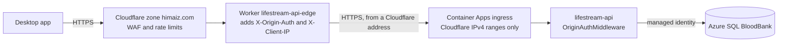

# Deployment and operations record

How Lifestream is hosted, deployed and protected, as it is live. Last checked against the live setup on 2026-11-22. The Azure
template, its runbook and the reasons behind each choice are in [infra/README.md](../infra/README.md); this page is the overview,
with what to do when something has to be undone.

No value of any secret is written here or anywhere else in this repository: only names, and where each one lives.

## What runs where

| Part | Hosted on | Name | Region or scope |
|---|---|---|---|
| Desktop app (WPF, .NET 11) | the user's PC; installers and updates on [GitHub Releases](https://github.com/maiznadeem/Lifestream/releases) | `Lifestream-win-Setup.exe`, Velopack update feed | Windows 10 and 11, x64 |
| API (ASP.NET Core 11) | Azure Container Apps, Consumption plan, resource group `Lifestream` | container app `lifestream-api` in environment `lifestream-env` | East US (the resource group itself is in West Europe) |
| Migrations | Azure Container Apps job, manual trigger | `lifestream-migrate` (same image, argument `--migrate`) | East US |
| API image | GitHub Container Registry | `ghcr.io/maiznadeem/lifestream-api:<commit sha>`, newest 3 kept | public package |
| Edge | Cloudflare Worker on the `himaiz.com` zone | `lifestream-api-edge` (source `edge/api`) | Cloudflare's network |
| Database | Azure SQL, free offer (serverless, auto-pause) | server `lifestream-server`, database `BloodBank` | East US |
| SQL audit log | Log Analytics workspace | `lifestream-audit` | 31-day retention, 0.1 GB daily cap |
| API and migrate job logs | Log Analytics workspace, the environment's log destination | `lifestream-logs` | 30-day retention, 0.05 GB daily cap |

The API scales to zero (0 to 1 replica). A request after about five idle minutes starts a container, and the database pauses after
15 minutes without a session, so a fully cold first request takes 1 to 2 minutes. The desktop app shows that wait as it happens.
Nothing here bills while idle: see "Why nothing here bills" in [infra/README.md](../infra/README.md). There is no mobile app.

## Logs

Every part writes one JSON object per line in the shape of OracleVMOps `LOGGING.md` (`time`, `level`, `app` = `lifestream`, `part`,
`event`, `ray`, `msg`; request lines add `method`, `route` as a pattern such as `/api/v1/donors/:id`, `status`, `ms` and the numeric
`user` id). Argus collects them.

- **API** (`part: api`) and **migrate job** (`part: worker`): `StandardJsonFormatter` writes the console lines; Container Apps sends them
  to `lifestream-logs` (table `ContainerAppConsoleLogs_CL`, platform events in `ContainerAppSystemLogs_CL`). Health and readiness checks
  are `debug`, every other 5xx is `error`, an exception is `error` with `event: exception` and carries its type and stack, never its
  message. No body, header, token, query string or raw path is logged. `LOG_LEVEL` (debug, info, warn, error) overrides the level.
- **Edge** (`part: edge`): the Worker logs one line per request to Workers Logs and forwards the visitor's ray as `X-CF-Ray`, which the
  API logs as `ray` (Cloudflare gives the Worker's own call to the origin a new `CF-Ray`). Filter on one ray to see a request at both.
- **Access:** Argus's Entra app has Reader on the resource group, which includes running log queries
  (`Microsoft.OperationalInsights/workspaces/query/*/read`); no other role is needed.
- **Cost:** both workspaces are capped (0.1 + 0.05 GB a day, at most 4.5 GB a month), inside the billing account's free 5 GB a month,
  and retention up to 31 days is included. When a cap is reached, ingestion stops until the next UTC day.

## Domains

| Hostname | Served by | Notes |
|---|---|---|
| `api.lifestream.himaiz.com` | the Worker `lifestream-api-edge` (custom domain, proxied) | The only public address of the API. The desktop app's `Api:BaseAddress` points here. |
| `lifestream-api.mangotree-b12eb44b.eastus.azurecontainerapps.io` | Azure Container Apps ingress | The origin. It answers only Cloudflare's addresses, and only requests carrying the Worker's secret; everyone else gets 403. |
| `github.com/maiznadeem/Lifestream/releases` | GitHub | Installers, checksums and the update feed the app reads. |

## The request path

## Cloudflare

- **Zone and WAF.** The API sits behind the `himaiz.com` zone. The zone's WAF custom rules, its rate-limiting rule and its settings
  are shared by all of the owner's projects. They are managed centrally, not from this repository, and recorded in the private
  repository `maiznadeem/OracleVMOps` (`cloudflare/README.md`). Change them there, never from here.
- **What the zone does for this API.**
  - It blocks common scanner paths: `/.env` answers 403 at Cloudflare.
  - It applies the shared rate limit.
  - `api.lifestream.himaiz.com` is exempt from the zone's browser checks, because a desktop client cannot solve a challenge.
- **Origin lock** (the shared record calls this "Pattern A").
  - **The secret header:** the Worker adds `X-Origin-Auth` (its secret) and `X-Client-IP` (from `CF-Connecting-IP`) to every request. The API's
    `OriginAuthMiddleware` compares the header in constant time. It trusts `X-Client-IP` only when the secret matches, and strips both headers.
  - **Enforcement:** `OriginAuth__Mode` is `enforce`, so a request without the right secret gets 403. `log` only logs it, for a rollout or an
    incident. `/healthz` is exempt, because the platform's startup probe calls it. The API refuses to start in `enforce` mode without a
    secret, or with one shorter than 32 characters.
  - **Address allow-list:** the container app's ingress accepts only Cloudflare's 15 published IPv4 ranges (`ingressAllowedRanges` in
    `infra/main.bicep`, applied as `ipSecurityRestrictions` named `cloudflare-1` to `cloudflare-15`). The origin has no IPv6 address.
- **Keeping the ranges current.** This is done by hand, with a weekly alert: `cloudflare-ranges.yml` fails every Monday the list differs from
  `https://www.cloudflare.com/ips-v4`, and prints the added and removed ranges. Cloudflare publishes its ranges at `https://api.cloudflare.com/client/v4/ips` and
  announces changes in advance. When they change, update `ingressAllowedRanges` and apply the template. The live rules can also be set at once with
  `az containerapp ingress access-restriction set --subscription 88f308cf-f1e5-4e4d-b0bc-3e8b14ef9c65 -g Lifestream -n lifestream-api ...`.
  A missing range shows up as 403 for visitors whose Cloudflare data centre uses it.
- **Bot protection.** The zone's WAF and rate limit, as above, plus the API's own limits (`Limits` and `Demo` settings):
  - 600 requests a minute per visitor;
  - 10 sign-in attempts and 6 demo sign-ins a minute per visitor;
  - a lockout after repeated failed passwords;
  - 200 demo writes per address per day;
  - a cap on how far any demo table can grow.

  The visitor is the address Cloudflare saw (an IPv6 visitor is counted per /64). There is no Turnstile: the client is a desktop
  app, not a web page.

## CI

All workflows are in `.github/workflows`. Only short jobs start by themselves; the full build and every test run locally before a push.

| Workflow | Starts on | Checks |
|---|---|---|
| `ci.yml` | pull request, push to `master` | job `fast`: builds Client and Domain (warnings are errors) and runs their tests, within a 90-second budget. The `api`, `desktop` and `test-order` jobs run only when started by hand. |
| `secret-scan.yml` | pull request, push to `master`; Mondays 04:17 UTC | the credential scanner over the source and the new commits, plus gitleaks over the history. The Monday run scans every branch and tag. |
| `deploy-api.yml` | push to `master` that changes `src/Lifestream.Api`, `Data`, `Contracts`, `Domain` or `infra/`, unless every changed file is Markdown (`*.md`); or by hand | the CD job below |
| `cloudflare-ranges.yml` | Mondays 05:23 UTC; or by hand | compares `ingressAllowedRanges` in `infra/main.bicep` with `https://www.cloudflare.com/ips-v4` (`tools/check-cloudflare-ranges.sh`). Changes nothing; a failed run, which GitHub emails to the owner, means the ranges drifted or could not be read. About 10 seconds. |
| `release.yml` | by hand only | a fallback for the desktop release (see below) |
| `screenshots.yml`, `sync-sql-firewall.yml` | by hand only | regenerates the README screenshots; makes the SQL firewall match the environment's outbound addresses |

GitHub Actions signs in to Azure with OIDC as the identity `lifestream-deployer` (federated credential for this repository's `master`
branch, Contributor on the resource group). The repository has **no Actions secrets**. Its variables `AZURE_CLIENT_ID`,
`AZURE_TENANT_ID` and `AZURE_SUBSCRIPTION_ID` are identifiers, not secrets.

## CD

**API** (`deploy-api.yml`, about 5 minutes):
1. builds the image, scans every layer, its configuration and the build log for credentials, and pushes it to GHCR tagged with the commit SHA;
2. checks that the SQL server still has Entra-only authentication;
3. runs `lifestream-migrate` on the new image and waits for it to succeed;
4. points `lifestream-api` at the new image (single revision mode);
5. waits for `https://api.lifestream.himaiz.com/healthz` to return 200, through Cloudflare;
6. prunes GHCR to the newest 3 versions and verifies that the deployed one is among them.

**Infrastructure** (`infra/main.bicep` with `infra/main.bicepparam`): applied by the owner from a shell, never by CI. Personal and
secret values come from environment variables read by the parameter file. The order of operations is in
[infra/README.md](../infra/README.md). `deploy-api.yml` runs on `infra/` changes too, but only to deploy the app; it never applies the template.

**Edge Worker** (Cloudflare Workers Builds, since 2026-11-22): connected to this repository.
- **Branch:** `master`.
- **Root:** `/edge/api`, with no build command.
- **Deploy command:** `npx -y wrangler@4 deploy`.
- **Watch path:** `edge/api/*`, so only a change there deploys it. Preview builds are off.

The Worker secret `ORIGIN_AUTH` survives deploys. The Worker has no `workers.dev` address and no preview URLs. A deploy by hand still
works from `edge/api` with `npx wrangler@4 deploy`.

**Desktop app**: released from the maintainer's PC with `tools/release-local.ps1`. It publishes, scans, packs with Velopack, scans
again, writes `SHA256SUMS.txt` and creates the GitHub release and its tag. A tag starts no workflow. Installed apps update themselves
from the latest GitHub release. Details: "How a release is made" in the [README](../README.md#releases).

## Rollback

| Part | How |
|---|---|
| API | Point the app at one of the 3 kept images: `az containerapp update --subscription 88f308cf-f1e5-4e4d-b0bc-3e8b14ef9c65 -g Lifestream -n lifestream-api --image ghcr.io/maiznadeem/lifestream-api:<previous sha>`. Or revert the commit on `master`, which redeploys. Migrations only go forward, so rolling back across a schema change needs an older image that works with the newer schema. Otherwise ship a fix forward. |
| Database | Point-in-time restore, up to 7 days back (the most the free offer allows), into a new database. Then switch the connection string. |
| Edge Worker | `npx wrangler@4 rollback` from `edge/api` (or the Worker's Deployments page in the Cloudflare dashboard) returns to the previous version at once. Reverting the commit on `master` makes Workers Builds deploy the old code. |
| Origin lock | For an incident only: set `OriginAuth__Mode` to `log` (`az containerapp update --subscription 88f308cf-f1e5-4e4d-b0bc-3e8b14ef9c65 -g Lifestream -n lifestream-api --set-env-vars OriginAuth__Mode=log`). Remove the ingress allow-list with `az containerapp ingress access-restriction remove --subscription 88f308cf-f1e5-4e4d-b0bc-3e8b14ef9c65 ...`. Put both back afterwards: the template's defaults are the locked state. |
| Desktop app | Velopack only moves to a higher version. Mark a bad release as a pre-release or delete it so that no new install or update takes it, then release the fix (or the previous code) under a new, higher version. |
| Infrastructure | Apply the template from the previous commit. Never with `--mode Complete`. |

## Secrets

Names and places only. The owner's copies are in a local encrypted store on the maintainer's PC.

| Secret | Where it lives | Used by |
|---|---|---|
| `jwt-signing-key` | Container Apps secret on `lifestream-api` (env `Jwt__SigningKey`) | signs and checks access tokens |
| `origin-auth` | Container Apps secret on `lifestream-api` (env `OriginAuth__Secret`) | must equal the Worker secret `ORIGIN_AUTH` |
| `ORIGIN_AUTH` | Cloudflare Worker secret on `lifestream-api-edge` | sent as `X-Origin-Auth` |
| `owner-admin-password` | Container Apps secret on the job `lifestream-migrate` (env `Owner__AdminPassword`) | creates the protected owner admin account |

The template reads these values only from the environment of the shell that applies it (`LIFESTREAM_JWT_SIGNING_KEY`,
`LIFESTREAM_ORIGIN_AUTH`, `LIFESTREAM_OWNER_ADMIN_PASSWORD`). There is no Key Vault, and there are no GitHub secrets. The database has no
password at all: both identities sign in with Entra ID.

## Data

- **Database:** `BloodBank` on `lifestream-server`, on the Azure SQL free offer. It is serverless, auto-pauses, and pauses for the rest of
  the month if the free allowance runs out. Only the API and the migrate job connect to it.
- **Access:** the server allows Microsoft Entra ID authentication only, so no SQL logins exist. Its firewall holds the environment's
  outbound addresses and the "Allow Azure services" rule, so authentication is the real control (see Security trade-offs in
  [infra/README.md](../infra/README.md)).
- **The app's database user:** `lifestream-api`, the API's system-assigned managed identity. It holds `db_datareader`, `db_datawriter`
  and `EXECUTE` only, so it cannot change the schema.
- **The migration user:** `lifestream-migrator`, a user-assigned identity, is the only one that runs DDL, from the migrate job.
- **What the data is:** the public demo holds made-up people only, and resets every UTC day; see
  [docs/data-retention.md](data-retention.md). The schema is in [docs/database.md](database.md).
- **Auditing:** SQL sign-in and schema-change events go to `lifestream-audit`. Row-level changes are recorded in the API's own
  `AuditLog` table.
